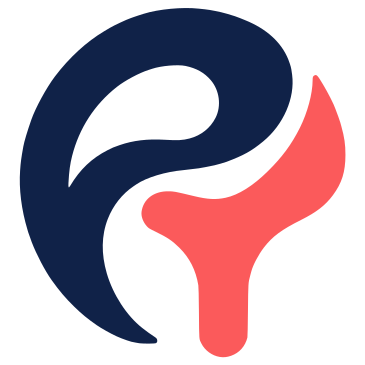

# Pokayoke Brand Identity

The single reference for how Pokayoke looks, sounds and is laid out. Use the files in this folder rather than copying values by hand.

| File | Use |
|---|---|
| [`tokens.css`](tokens.css) | Colours, fonts, type scale, spacing, radii, motion. Import once at the app root |
| [`logo/`](logo/) | Logo mark in every approved version (SVG) plus the original image |
| [`brand-sheet.html`](brand-sheet.html) | Visual reference of everything below on one page |
| [`console-color-demo.html`](console-color-demo.html) | The brand applied to a console screen (sample data), with a colour wheel for experiments |

---

## 1. Name

**Pokayoke** (one word, capital P), pronounced "POH-kah YOH-keh".

From the Japanese *poka-yoke*, "mistake-proofing", formalised by Shigeo Shingo in the Toyota Production System in the 1960s. Any mechanism in a process that stops, corrects, or flags a human error as it happens. Shingo first called it *baka-yoke* ("fool-proofing") and renamed it, because people are not fools; processes should catch the mistakes anyone can make.

Shingo described two kinds, and the product is both:

- **Warning poka-yoke** alerts the operator before the mistake completes. Pokayoke shows the analyst evidence-backed findings before submission.
- **Control poka-yoke** physically prevents the mistake. Pokayoke's gate keeps held records out of the accepted destination.

Write the product name as **Pokayoke**. Write the manufacturing concept as **poka-yoke** (lowercase, hyphenated) when referring to it as a method.

---

## 2. Logo

A navy **P** and a coral **Y** drawn as fluid, calligraphic strokes that lock into one closed form.

### What the mark means

| Part | Reading |
|---|---|
| The navy P's sweep | The client's data flow. It arcs around the whole mark like a protective hand, so the shape reads as contained even though the stroke never fully closes (Gestalt closure) |
| The P's teardrop counter | A single drop of data, the unit of work Pokayoke looks at |
| The coral Y | The checkpoint. Its fork is the decision point where each record is passed or held; its stem anchors the mark like a pin, the guide pin of a physical poka-yoke device |
| Where P meets Y | The P's tail flows into the Y's arm: data passes through the check without breaking the flow |
| Navy and coral | Navy is the trusted system; coral is the moment of attention. The same rule governs the whole interface |

### Versions

| File | When |
|---|---|
| `pokayoke-mark.svg` | Default, on cream or white |
| `pokayoke-mark-reversed.svg` | On navy or dark surfaces (cream P, coral Y) |
| `pokayoke-mark-mono.svg` | One-colour navy: print, documents, stamps, watermarks |
| `pokayoke-mark-mono-white.svg` | One-colour white on photos or dark colour |
| `pokayoke-app-icon.svg` | Favicon, app icon, console sidebar collapsed state |

### Lockup

Mark on the left, **Pokayoke** wordmark on the right, set in Plus Jakarta Sans SemiBold (600), letter-spacing -1%, navy.

- Wordmark cap height is about 45% of the mark's height.
- Gap between mark and wordmark is about 25% of the mark's width.
- Vertically centre the wordmark on the mark.

### Clear space and minimum size

- Keep clear space on every side equal to **25% of the mark's width**. Nothing enters it.
- Minimum size: **20px** wide on screen for the mark alone, **96px** wide for the full lockup. Below 20px, use the app icon.

### Do not

- Swap the colours (coral P, navy Y) or use any other colours.
- Add gradients, shadows, outlines, glows or 3D effects.
- Rotate, stretch, or redraw the strokes.
- Place the full-colour mark on coral, or on busy photography.
- Separate the P and Y or use either letter alone.

---

## 3. Colour

Proportion on any screen: **about 90% navy and neutrals, under 5% coral**, status colours only where they report status.

### Brand

| Token | Hex | Role |
|---|---|---|
| Navy | `#102248` | Primary brand colour: text, headings, primary buttons, sidebar |
| Coral | `#FB5A5B` | Attention only: the logo Y, held records, red-pen underline on a bad value, counts awaiting review. Never on primary buttons or decoration |
| Cream | `#F6F2E4` | Light page background |

### Light theme (default: marketing site, analyst workspace)

| Token | Hex | Use | Contrast |
|---|---|---|---|
| `--bg` | `#F6F2E4` | Page | |
| `--surface` | `#FFFFFF` | Cards, drawers | |
| `--ink` | `#102248` | Main text | 13.9:1 on cream |
| `--ink-2` | `#5A6378` | Slate: labels, timestamps, helper text, secondary columns | 5.4:1 |
| `--line` | `#DDD6C3` | Hairline borders | |
| `--link` | `#2F5FD0` | Links, focus | 5.1:1 |
| `--mark` | `#FB5A5B` | Coral marks and icons | 2.8:1, so not for text |
| `--mark-text` | `#C23B3C` | Coral as text | 4.7:1 |

### Dark theme (console, `data-theme="dark"`)

| Token | Hex | Contrast |
|---|---|---|
| `--bg` | `#0A1430` | |
| `--surface` | `#14234A` | |
| `--ink` | `#F6F2E4` | 13.7:1 on surface |
| `--ink-2` | `#A3ACC2` | 6.8:1 on surface |
| `--link` | `#8FB0FF` | 7.2:1 |
| `--mark` | `#FB5A5B` | 4.9:1 |

### Status

Every status shows **colour, icon and word together**. Colour alone is never the signal.

| Status | Light | Dark | Icon (Lucide) |
|---|---|---|---|
| Ready / pass | `#0F7B6C` | `#4FD1B5` | `check` |
| Auto-fixed (vision) | `#2F5FD0` | `#8FB0FF` | `wand` |
| Held | `#C23B3C` | `#FF8A80` | `octagon-pause` |
| Needs verification / ask | `#9A5B00` | `#F5B544` | `circle-help` |

Severity reuses the same colours: **High** = held red, **Medium** = ask amber, **Low** = slate.

---

## 4. Typography

| Role | Typeface | Weights | Where |
|---|---|---|---|
| Display and headings | **Plus Jakarta Sans** | 600, 700 | Wordmark, page titles, section headings, marketing headlines |
| Interface and body | **Inter** | 400, 500, 600 | All UI text, paragraphs, buttons, tables |
| Data | **JetBrains Mono** | 400, 500 | Values, record IDs, field names, timings, code |

All three are free on Google Fonts and loaded by `tokens.css`.

**Why these:** Plus Jakarta Sans has round, open forms that echo the mark's curves while staying professional. Inter is built for dense interfaces and has tabular numerals, so figures line up in tables. JetBrains Mono makes data look like data and keeps `0` and `O`, `1` and `l` distinct, which matters when the product is about catching wrong values.

### Scale

| Token | Size | Line height | Font |
|---|---|---|---|
| `--text-display` | 56px | 1.05 | Jakarta 700, marketing hero only |
| `--text-h1` | 40px | 1.1 | Jakarta 700 |
| `--text-h2` | 30px | 1.2 | Jakarta 700 |
| `--text-h3` | 22px | 1.3 | Jakarta 600 |
| `--text-h4` | 18px | 1.4 | Jakarta 600 |
| `--text-body-lg` | 17px | 1.6 | Inter 400, marketing |
| `--text-body` | 15px | 1.55 | Inter 400, app |
| `--text-small` | 13px | 1.5 | Inter 400/500 |
| `--text-caption` | 12px | 1.4 | Inter 500, smallest allowed |

Rules: sentence case for headings and buttons. Headings tighten to -1.5% letter-spacing. Use size and space for hierarchy before weight. Numbers in tables always use the mono or Inter tabular figures.

---

## 5. Structure

### Spacing and shape

- **4px base grid**: 4, 8, 12, 16, 24, 32, 48, 64, 96.
- **Radii**: 6px controls, 10px cards and findings, 16px modals and hero panels, pill for status chips.
- **Borders over shadows.** 1px hairlines separate surfaces. A soft shadow only on floating elements (drawers, menus, toasts).
- No gradients, glows, glassmorphism or background patterns.

### Layout grid

| Surface | Grid |
|---|---|
| Marketing site | 12 columns, 1200px max content width, 24px gutters; 96px between sections on desktop, 64px on mobile |
| Analyst workspace | Top bar (64px) with the logo lockup, workspace name and user; content max 1200px; a step indicator for the journey |
| Console | 240px navy sidebar (logo, navigation), fluid content; dark theme by default with a light switch |

### Surfaces and their structure

The current build scope is one analyst journey (see `docs/problem/first-iteration-solution.md`). The brand covers three surfaces:

1. **Marketing site** (light). Hero with the vision and a "See it work" call to action; the problem (why plausible-but-wrong values get through); how it works as a flow (upload, understand, check, investigate, resolve, release); the poka-yoke story; security and audit; call to action.
2. **Analyst workspace** (light). The first-iteration journey as clear steps: **Upload → Confirm details → Save profile → Review findings → Resolve → Submit**. Each step has one primary action in navy. Findings use the status and severity system, show evidence and the linked procedure, and mark the bad value with the coral red-pen underline.
3. **Console** (dark, vision and operations view). Feed of reviews and gate decisions, run traces, profiles and checks, metrics, audit log. Shows only what the backend actually reports.

### Components

| Component | Rule |
|---|---|
| Primary button | Navy fill, cream text (dark theme: cream fill, navy text). One per view |
| Secondary button | Transparent, 1px `--line` border, ink text |
| Status chip | Pill, 1px border and text in the status colour, tinted background, icon + word |
| Finding card | 10px radius, `--surface-2`, title + severity badge, evidence sentence, proposed action, source checks in mono slate, procedure link |
| Red-pen underline | `text-decoration: underline wavy var(--mark)` on the suspect value only |
| Tables | Slate column headers, hairline rows, mono right-aligned numbers, selected row marked with a 3px coral left bar |

---

## 6. Iconography and imagery

- **Lucide** icons, outline style, 1.5 to 2px stroke, 16 to 20px in UI. No filled or 3D icons.
- No stock photography and no robot, brain, sparkle or circuit imagery.
- Illustrations, when needed, use the mark's language: one flowing navy line, a coral point where it is checked.

---

## 7. Motion

- Things move along paths, the way data flows: a record slides into a list, a trace step draws in.
- 150 to 220ms with the `--ease-out` curve. No bounce, spin or attention-seeking loops.
- Loading: the P's sweep draws once, then the Y settles in.
- Progress must reflect real backend state; never animate fake progress.
- Respect `prefers-reduced-motion`.

---

## 8. Voice

Calm, exact, plain. Pokayoke speaks like a careful colleague, not a mascot.

| Do | Don't |
|---|---|
| "Held: 311,583.70 is 8.8x the previous value." | "Oops! Something looks off 😬" |
| "Verify the figure against the source report." | "Our AI magically fixed it!" |
| "Checked 300 records. 4 need your review." | "Crushing bad data at scale 🚀" |
| "Catch rate 0.82 on 60 reviewed records." | "Catches 99% of errors" (unmeasured) |

- Name the record, the field and the value. Give the evidence, then the action.
- State numbers with how they were measured.
- No exclamation marks in product copy. No "please", "simply", "just" or "magic".
